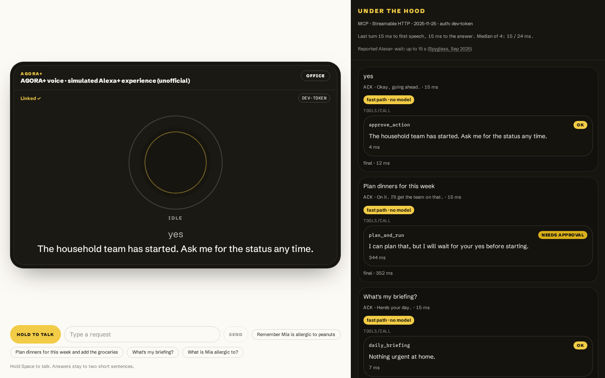
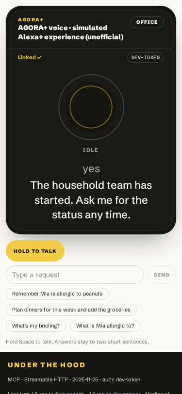
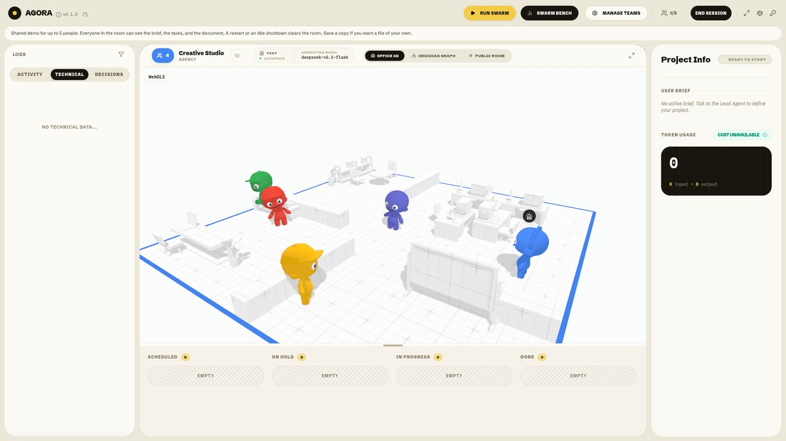
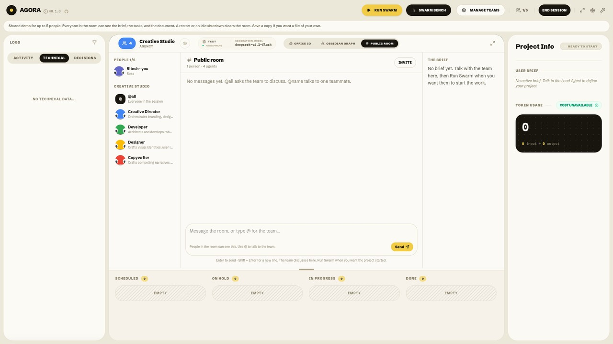
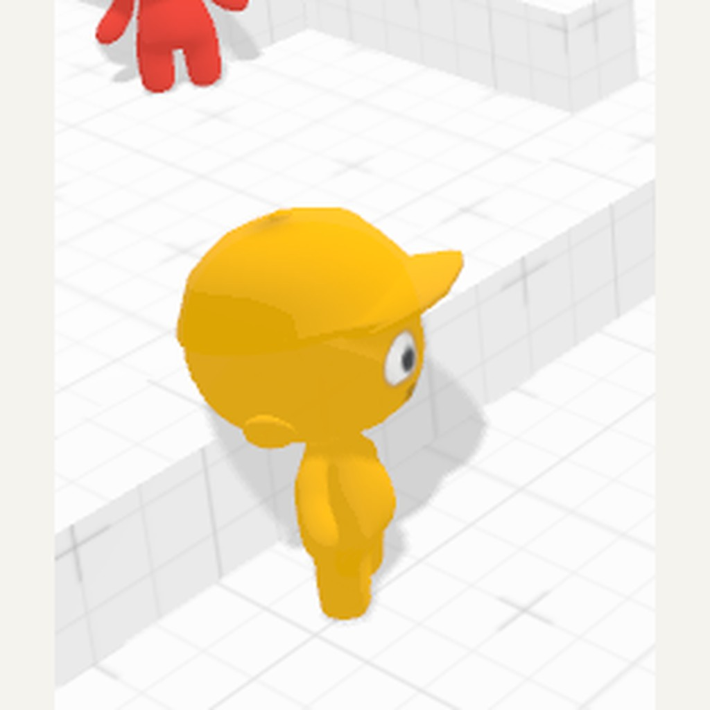
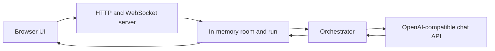

# AGORA+

Household memory is a file on a server you run. Every write returns a receipt whose `verified` flag is a second read of that file. Nothing with side effects starts until a person says yes, and that wait is in the tool result, not only in a prompt.

The surfaces that were run for this entry are the unofficial voice page at `/alexa` and the MCP server at `/mcp`, used from Claude Code with `AGORA_MCP_TOKEN`. MCP clients such as Alexa+ add-ons, Claude, and ChatGPT can connect to that same server. ChatGPT was not run against it, and a live Alexa+ add-on was not deployed. The add-on package in [alexa-addon/addon.json](alexa-addon/addon.json) is still a template: every URL contains `<host>`.

It is the AGORA office plus a household layer added for the Amazon Developer Hackathon (Alexa+ track). The office still draws the session in 3D. The household cast there is Agora, Scout, Planner, and Keeper. The new surface is the voice page, the MCP server, and files on disk.



## Why

Other assistants already advertise family memory, shopping lists, and device control. Claude can already see devices through other connectors. This server keeps household facts on the machine you run, and a plan does not start until a person says yes. Lights, locks, calendars, and countdown timers are not in this build.

Four complaints from the 8 Oct 2026 research pass. Quotes and the source list are in [docs/research/alexa-plus-voice-of-customer.md](docs/research/alexa-plus-voice-of-customer.md) and [docs/research/sources.json](docs/research/sources.json). The demo paraphrases these. It does not put the article sentences on screen.

- **Jobs stop halfway.** Reviews and forum posts describe routines and multi-step tasks that do not finish. Wired (6 Mar 2026) describes half-completed tasks. AGORA+ shows the steps and waits for a yes before the team starts. The receipt on a write is a separate thing: `verified` is a read-back from disk.
- **Replies take too long.** Spyglass (30 Sep 2025): "Alexa Plus is noticeably slower, with some requests taking up to 15 seconds for a response." The Verge (8 Oct 2026) says timers and weather execute in three to five seconds ([review](https://www.theverge.com/tech/1007565/amazon-alexa-plus-review-one-year-echo-show-dot-max)). The voice page cites both and labels its meter time to first audio on the fast path. That AGORA+ number is `TODO(measure)`. A turn that never starts audio reads "text only".
- **A stored fact disappears.** Consumer Reports (19 Dec 2025) saved a recipe that Alexa+ recalled at first and did not have two weeks later. `remember`, `recall`, and `forget` are backed by `memory.json` and the MCP resource `agora://memory`. A fact can name a person (`who`). The Household panel can edit it.
- **People want a checkpoint.** Stack Overflow (27 May 2026, 1,100 technologists): "63% of technologists still rarely or never let agents run entirely on autopilot," and 60% block unapproved system changes. `forget` and `plan_and_run` return `needs_approval`. Remembering a fact and adding a task do not wait. On `/alexa` the model cannot call `approve_action`. A person says an exact yes or no, or uses a button. `approve_action` stays an MCP tool for external clients.

## What it does

- **Household Home** at `/` (also `/alexa`). This is the page to open first. A greeting with the briefing, the assistant, Today's reminders, the Shopping and To-do lists (tick, untick, remove, clear the basket), Family facts grouped by person with Allergy, Diet, and Medical badges, and Plans. While a plan runs, the Plans card shows each team member's step and its status; a finished plan opens in the page. **Connect** shows the `/mcp` endpoint and the `claude mcp add` command. **Under the hood** opens the MCP trace beside the page.
- **Voice assistant** on Home. Unofficial simulated Alexa+ experience. Type, or tap or hold to talk. Remember, recall ("What is Mia allergic to?"), the briefing, the shopping list, reminders, and an exact yes or no are routed with no model call ([server/alexaSim/fastPath.ts](server/alexaSim/fastPath.ts)). A plan still asks Bedrock once for the step list, and only after that preview returns steps does the page wait for a yes. Orders, purchases, bookings, payments, and phone calls are refused, with no approval id. The page shows an "Under the hood" trace of each MCP `tools/call`. While it is open it polls `GET /api/household` about every 30 seconds and speaks "Reminder: &lt;title&gt;." once per due task per page load.
- **MCP server** at `/mcp`. Eleven tools always, and `web_research` as a twelfth when `FIRECRAWL_API_KEY` or `EXA_API_KEY` is set. Three resources (`agora://memory`, `agora://tasks`, `agora://runs/{id}/document`) and two prompts (`morning-briefing`, `plan-a-week-of-meals`). Streamable HTTP. The server negotiates protocol 2025-11-25 and newer ([server/mcp/mcp.test.ts](server/mcp/mcp.test.ts)). Alexa's published client sample sends `2025-03-26`. The specification index on 8 Oct 2026 names 2026-07-28 as current ([docs/council/reports/g4-spec-followup.md](docs/council/reports/g4-spec-followup.md)). OAuth is in [server/mcp/oauth.ts](server/mcp/oauth.ts). `daily_briefing` and `list_tasks` put the MCP Apps card on the tool result as well as the tool definition (`ui://daily_briefing/household-card.html`).
- **People, lists, and reminders.** A fact can store `who` (a leading name such as "Mia is allergic to peanuts" is enough). A task can store `who`, `list` (`shopping` is its own list; absent means the main to-do list), and `dueAt` (ISO 8601 with a numeric offset). The free-text `due` stays. The briefing speaks one memory line, allergies and medicine first ("Remember: Mia is allergic to peanuts."). Recall says both facts when they tie.
- **Agent Skill** [skills/agora-household/SKILL.md](skills/agora-household/SKILL.md). How to connect, which tool to call, and the rule that a `needs_approval` result waits for a person.
- **Household team** on Amazon Bedrock, only when `AGORA_SERVER_LLM=bedrock` and AWS credentials are present: Agora, Scout, Planner, and Keeper ([server/household/team.ts](server/household/team.ts)). `AGORA_SERVER_LLM=openai` runs the same team on any OpenAI-compatible endpoint (`AGORA_LLM_*` in [.env.example](.env.example), [server/llm/openaiProvider.ts](server/llm/openaiProvider.ts)). The plans recorded in this workspace used that mode with open Qwen models on Featherless, because no AWS credentials were present. A step whose model call fails is marked for help and the rest of the team finishes. That set is the office default. Keeper checks plans against memory. Claude is called through the Messages endpoint ([server/llm/bedrockProvider.ts](server/llm/bedrockProvider.ts)). A live Bedrock call was not recorded in this workspace.
- **Polly** speaks when AWS credentials are present ([server/alexaSim/tts.ts](server/alexaSim/tts.ts)). The browser voice speaks when Polly returns 503. A successful Polly synthesize was not recorded. Time to first audio is `TODO(measure)`.
- **Approvals and receipts.** `forget` and `plan_and_run` wait. Remembering and adding a task do not. Every write can show `{ action, id, verified, at }`. `verified` is a follow-up read. A failed yes leaves the approval pending so it can be retried. Waiting approvals still live in the process and expire after ten minutes.
- **3D office** at `/office`. The Household cast is the roster. A household run is written to `runs/<id>.json` with `status: "running"` when it starts, and again when it ends. The Society panel shows `spokenSummary` when the run has one.
- **Alexa+ add-on package** in [alexa-addon/addon.json](alexa-addon/addon.json), plus [public/privacy.html](public/privacy.html) and [public/terms.html](public/terms.html). Account linking is enabled in the file (authorization code, PKCE S256). The manifest lists the United States only, and every URL is still `https://<host>/...`. `alexa-ai` was not deployed from this workspace.

The file map is [docs/ARCHITECTURE.md](docs/ARCHITECTURE.md).

## Screenshots

Captured:






Still to capture, under `docs/images/`:

- `docs/images/household-panel.png` — Household panel with a fact you can edit
- `docs/images/office-household-run.png` — Agora, Scout, Planner, and Keeper during a plan
- `docs/images/mcp-inspector.png` — Inspector tool list and OAuth
- `docs/images/claude-mcp-recall.png` — Claude Code asking what Mia is allergic to

## Quick start

You need Node.js and npm. The [Dockerfile](Dockerfile) uses Node 22. The repository does not declare an engines field.

```bash
git clone <REPO_URL>
cd agora-plus
npm ci
cp .env.example .env
```

The voice page, remember, the briefing, the shopping list, and recall do not need AWS. Bedrock and Polly run only when AWS credentials are on the standard chain (`aws login`, a profile, or a task role). For that path, in `.env` (values only, never commit the file):

```bash
AGORA_SERVER_LLM=bedrock
AWS_REGION=us-east-1
```

Bedrock defaults are `anthropic.claude-sonnet-5` and `anthropic.claude-haiku-4-5`. Override with `BEDROCK_MODEL` and `BEDROCK_FAST_MODEL` if you need to.

Claude Code needs a development token of at least 32 characters. A shorter value is ignored.

```bash
AGORA_MCP_TOKEN=choose-at-least-32-random-characters
```

OAuth also needs `AGORA_OAUTH_CLIENT_ID`, `AGORA_OAUTH_CLIENT_SECRET`, and `AGORA_TOKEN_SECRET` (at least 32 characters). A public process also needs `AGORA_PUBLIC_URL` and `AGORA_HOUSEHOLD_PASSCODE`. If the OAuth secrets are empty, those routes return 503 and the development token is the one that can call tools. The token is ignored when `NODE_ENV=production` or `AGORA_PUBLIC_URL` is https, unless `AGORA_ALLOW_DEV_TOKEN=1`.

```bash
npm run dev
```

`npm run dev` starts Vite on port 3000 and binds `127.0.0.1`, with the room relay and `/mcp`. Open [http://127.0.0.1:3000/](http://127.0.0.1:3000/) for the household Home. The optional 3D team view is [http://127.0.0.1:3000/office](http://127.0.0.1:3000/office). `/alexa` is the same Home. `npm run dev:lan` binds `0.0.0.0`. On that bind, `/mcp` and OAuth return 503 until `AGORA_PUBLIC_URL` is set, and household routes from another machine return 403 until `AGORA_HOUSEHOLD_PASSCODE` is set.

### Environment

Names the server reads. Empty in [.env.example](.env.example) means unset. The full table, including office and deploy names, is [docs/DEPLOY.md](docs/DEPLOY.md). Do not commit real values.

| Variable | What it does |
| --- | --- |
| `AGORA_HOUSEHOLD_PASSCODE` | When set, household HTTP routes need the `agora_household` cookie. Production listens on `0.0.0.0` only when this is set. Five wrong guesses, then 15 minutes and HTTP 429. |
| `AGORA_MCP_TOKEN` | Development bearer for Claude Code and the Inspector. At least 32 characters. Ignored in production or behind an https public URL unless `AGORA_ALLOW_DEV_TOKEN=1`. |
| `AGORA_ALLOW_DEV_TOKEN` | Set to `1` to keep the development token in those cases. |
| `AGORA_TOKEN_SECRET` | HMAC secret for access and refresh tokens. OAuth stays off when it is shorter than 32 characters. |
| `AGORA_OAUTH_CLIENT_ID` | OAuth client id. |
| `AGORA_OAUTH_CLIENT_SECRET` | OAuth client secret. HTTP Basic or the form body, never both. |
| `AGORA_OAUTH_REDIRECT_URIS` | Comma-separated exact `redirect_uri` values. The simulator's own `http://127.0.0.1`, `http://localhost`, and `::1` callbacks are always allowed. |
| `AGORA_PUBLIC_URL` | Public HTTPS origin, no path. Required before OAuth or `/mcp` will answer on a process that is not bound to loopback. |
| `AGORA_TRUST_PROXY` | Set to `1` before `X-Forwarded-Proto` affects the Secure cookie or the OAuth issuer. |
| `AGORA_DATA_DIR` | Household files. Default `.agora-data`. Refresh records are `oauth-refreshes.json` in this directory. |
| `AGORA_TIMEZONE` | Calendar day for "due today" and reminder times. The server reads it. `.env.example` does not list it yet. Unset uses the server's zone. |
| `AGORA_SERVER_LLM` | Set to `bedrock` to call Amazon Bedrock when the browser sent no key. |
| `DEMO_HOST_SECRET` | Room host code. On an open bind with no passcode, the office has no first-caller host. |

Other scripts:

```bash
npm run build        # client in dist/, and the household card
npm run preview      # static client only; no room and no MCP
npm run lint         # client typecheck
npm run lint:server  # server typecheck
npm test             # unit tests
npm run test:e2e     # Playwright; starts its own server on port 3000
```

`./run-agora.sh` is an optional Chrome launcher for hardware WebGPU on Linux. The office runs without it.

Hosting (named tunnel, ECS, Cloud Run) is [docs/DEPLOY.md](docs/DEPLOY.md).

## Connect from Claude Code or any MCP client

The skill is [skills/agora-household/SKILL.md](skills/agora-household/SKILL.md). With the development token:

```bash
claude mcp add --transport http agora http://127.0.0.1:3000/mcp --header "Authorization: Bearer $AGORA_MCP_TOKEN"
```

Any other client uses Streamable HTTP `POST http://127.0.0.1:3000/mcp` with `Accept: application/json, text/event-stream` and `Authorization: Bearer <token>`. A client-credentials token (`scope=mcp:service`) can list tools. Calling them needs `mcp:tools`, from the authorization-code grant or from `AGORA_MCP_TOKEN`.

Try: "What is Mia allergic to?" after you have saved that fact on `/alexa`.

## What changed during the hackathon (Aug 31 – Oct 23, 2026)

AGORA existed before the window. The baseline tag `pre-window` is commit `4f61371` (2026-08-20).

`git diff --stat pre-window..HEAD` on 8 Oct 2026, at commit `fa7a9c0`:

```
288 files changed, 29768 insertions(+), 2318 deletions(-)
```

That range is 40 commits, dated 2026-09-23 through 2026-10-08. September kept building the office (WebGL2, a swarm that finishes a document, Jev, replay). 8 Oct added the household brain and, later the same day, the fix wave: people on facts and tasks, the shopping list, reminders, the approval gate in the voice loop, the household lock, persisted OAuth refresh, the MCP Apps card on tool results, and the Household cast in the office.

The phase log is [docs/HACKATHON_CHANGES.md](docs/HACKATHON_CHANGES.md).

The number to read on `/alexa` is time to first audio on the fast path. It is `TODO(measure)`. Model-path and Polly numbers are `TODO(measure)`. Older local timings were acknowledgement and screen times, not first audio: phase 4 saw the acknowledgement on the wire in 5 ms and on screen in 50 ms and 63 ms; phase 6 logged 55–58 ms to that acknowledgement, about 100 ms for a full remember turn, and about 800 ms from "plan dinners" to the approval card when a preview existed.

## Tracks and licence

Tracks: Alexa+ (primary), AWS Builder, Open Source.

The window contribution is the household MCP work: the server, the skill, the voice page, and the files on disk. Source code is MIT. See [LICENSE](LICENSE). Bundled 3D models under `public/models/` are CC BY-NC 4.0 and are not needed for `/alexa`. See [LICENSE-ASSETS.md](LICENSE-ASSETS.md).

Copy-ready Devpost text is [docs/SUBMISSION.md](docs/SUBMISSION.md). Also: [docs/ARCHITECTURE.md](docs/ARCHITECTURE.md), [docs/AWS.md](docs/AWS.md), [docs/DEMO_SCRIPT.md](docs/DEMO_SCRIPT.md), [docs/FEEDBACK.md](docs/FEEDBACK.md), [docs/FRICTION_LOG.md](docs/FRICTION_LOG.md).

## Limits

- One household per server, and one office room in the memory of that process ([server/roomState.ts](server/roomState.ts), [docs/DEPLOY.md](docs/DEPLOY.md)). Waiting approvals and authorization codes are in that same process. Approvals expire after ten minutes. OAuth refresh records and the simulator's linked account are files and survive a restart.
- Household files are on the task disk (`.agora-data` or `AGORA_DATA_DIR`). Replacing the task deletes them unless that directory is on a volume. `POST /api/memory` and `POST /api/tasks` do not yet accept `who`, `list`, or `dueAt`. A fact that starts with a capitalised name still stores `who`. The MCP tools accept the fields.
- The Alexa+ add-on manifest distributes to the US only and was not deployed ([alexa-addon/addon.json](alexa-addon/addon.json)).
- No device control, no calendar, and no countdown timer. Lights, locks, and Hue routines stay out of the demo ([docs/research/feature-matrix.md](docs/research/feature-matrix.md)).
- The microphone uses Web Speech ([src/alexa/useSpeechInput.ts](src/alexa/useSpeechInput.ts)). Record in Chrome. The text box works when that API is missing.
- A live Bedrock call and a successful Polly clip were not recorded here. The build shell had no AWS credentials. Time to first audio is `TODO(measure)`.

No public deployment URL is recorded in this repository.

## The shared office


AGORA is Ritesh-Root’s open-source workspace where people and AI agents share tasks, chat, and one Markdown document. The session is drawn as a 3D office. When WebGPU and WebGL2 are both unavailable, the same session uses a 2D office.

This repository is a working local workspace, not a finished hosted product. A room lives in the memory of one server process. The current source includes a production process and host controls. No public deployment URL is recorded here.

## What you can do

Implemented in the current source:

- Join one shared room, up to five people, with a display name and a color. There are no accounts.
- Talk in the room. `@all` asks the team to discuss the idea. `@name` addresses one teammate. Chat does not start the document.
- The host submits a brief and starts the run with **Run Swarm**, then **Execute Swarm**.
- Watch planning, worker tasks, a debate when the run calls for one, and the assembled Markdown document.
- See the session in a 3D office (WebGPU, or WebGL2) or the 2D fallback.
- Save the document to your own machine as `agora-document.md`.
- Leave on your own, or, as host, end the session for everyone.
- Save more than one OpenAI-compatible model connection in this browser. One is the default. An agent can use another connection and override its model. Keys stay in the browser and are not stored in the room.
- Start the header’s benchmark control. That automated comparison is not a user study. See [Validation and performance](#validation-and-performance).

Not in this build: saved cloud rooms, accounts, spending caps, and host approval before a document edit becomes final. See [Roadmap](#roadmap).





## Joining the office

Install and run from [Quick start](#quick-start). Open `http://127.0.0.1:3000/` for the household Home. The optional 3D team view is `http://127.0.0.1:3000/office`.

On loopback, with no `DEMO_HOST_SECRET`, the first person to join is the host. On an open bind (`0.0.0.0`) with that secret unset, the first caller is not the host. The host seat is a household session, which exists only when `AGORA_HOUSEHOLD_PASSCODE` is set. With neither the secret nor the passcode, that room has no host. With the secret set, only a matching host code, or the server-issued resume token, makes someone the host. A display name does not. When a passcode is set, the office socket needs the `agora_household` cookie.

A browser-supplied model key stays in `localStorage` under Model connections. The room does not store it. With `AGORA_SERVER_LLM=bedrock` and AWS credentials, the office can call Bedrock when the browser sent no key. See [docs/AWS.md](docs/AWS.md).

## How a session works

1. People join the room. Everyone connected can see the brief, the tasks, the document, and public chat.
2. `@all` and `@name` send chat. The named agents can reply. That discussion does not create the document.
3. The host runs **Execute Swarm**. A second Execute while a run is active is refused with “A run is already in progress.”
4. Planning splits the brief into tasks. Workers run those tasks. An invalid worker output can be retried once.
5. Debate is conditional. With fewer than two usable worker outputs, there is no debate. Otherwise a conflict check runs. A skip does not debate. An ask-the-host result leaves a note. Any other result debates for up to two rounds, then the lead writes one Markdown document.
6. The default conflict check, used when `AGORA_DECIDER` is unset, takes that last path and debates whenever two usable outputs exist. `AGORA_DECIDER=jev` can skip, ask the host, or debate. Jev is a server-side decider. It is not a chat model and it does not write the document.
7. If the brief says “under 400 words,” the document may be at most 399 words. A word is a whitespace-separated span after trimming, and headings count. Up to two shortening passes may run. A draft that is still over the limit is kept and labelled “Needs revision: exceeds word limit.” If both the word limit and required sections fail, the word-limit label is the one shown. Repair calls are counted separately from the other model calls.
8. Section checks run only when the brief names problem, audience, priorities, and next steps. A miss is labelled “Needs revision: missing required sections.”
9. **Save a copy** downloads the Markdown. The room copy disappears when the process restarts.

**Leave room** drops only that person. **End session**, confirmed with **End for everyone**, is host-only. The server rejects anyone else with “Only the room host can end the session.” and does not wipe the room. A successful end stops scheduling, clears the room and the run, tells every client, and closes the sockets. A late model result cannot restore that document.

After you leave or the host ends the session, the page stays disconnected. An unexpected drop shows a reconnect screen. The separate **Watch a live run** control is an explicit local replay.

## System architecture



The browser shows the office, chat, task board, and document. In development, the Vite server attaches the relay and the `/api/cors-proxy` route. The production entry, [server/prod.ts](server/prod.ts), listens on `PORT` (8080 if unset). It binds `0.0.0.0` only when `AGORA_HOUSEHOLD_PASSCODE` is set, and `127.0.0.1` otherwise. It serves `dist/` and attaches the same relay and proxy.

One process holds one room: roster, the last 100 public chat messages, cabin assignment, and a single run. Stages reported on that run are planning, working, debating, assembling, and repairing.

The orchestrator asks an OpenAI-compatible `/chat/completions` endpoint. The browser proxy forwards only an `https` URL whose path ends in `/chat/completions`, and only when the caller sends `Authorization`. It refuses private, loopback, and link-local targets, and it refuses redirects.

The office room is still the memory of one process. A restart clears the roster, the chat, and the live run. Household facts, tasks, and finished runs are files under `.agora-data` (or `AGORA_DATA_DIR`). See [docs/ARCHITECTURE.md](docs/ARCHITECTURE.md).

## Model configuration

Open **Model connections** in the header. Each saved connection has a name, an OpenAI-compatible base URL, an API key, and a default model ID. **Test connection** calls that endpoint and shows a short error. It does not print the key.

One connection is the default for this browser. An agent uses that default unless you pick another connection for it. A model ID on the agent replaces the connection’s model only when it differs. Every browser connection uses the same chat-completions protocol. The server's Bedrock path is separate and uses the Claude Messages endpoint. See [docs/AWS.md](docs/AWS.md).

A single configuration saved earlier under `byok-config` is copied into the connection list on the next load. The key, URL, and model are kept. The copy is stored in this browser under `agora-model-connections`.

Key handling:

- Your connections and keys stay in this browser. Room state stores chat, tasks, and the document. It does not store keys.
- A caller key is sent as-is and is never replaced by the server key or by another connection’s key.
- A call without a caller key fails with “Add an API key for that model endpoint.” when the server is not on Bedrock. With `AGORA_SERVER_LLM=bedrock`, [server/relay.ts](server/relay.ts) uses the Bedrock provider instead.
- A failed call does not switch to another person’s key, or to a different saved connection.
- The browser proxy copies the caller’s `Authorization` header and does not attach the server key.
- Provider failures shown in the room are short messages, such as “The API key was rejected.” or “That model is not available.” The provider body and the key are not shown.

Do not commit keys. `.env` is gitignored.

## Validation and performance

These are **reported local validation results** from clean commit `6983ddc` (“Keep a swarm document inside the brief and one active run per room.”). They are functional gate checks. They are not real-user benchmarks and they are not proof of usefulness. This README pass did not rerun them. Later commits, including the production entry and host controls, are not covered by this table.

| Check | Run | Recorded result |
|---|---|---|
| Consecutive film brief 1 | `0c4df963` | 258 words |
| Consecutive film brief 2 | `cef22a0f` | 349 words |
| Consecutive film brief 3 | `97163fb1` | 396 words; one repair |
| WebGL-disabled completion | `33b3584e` | 302 words; 2D fallback |
| Workers reload, first attempt | `6e0e9d8c` | State restored and duplicate Execute refused; model timed out after three HTTP attempts; no document |
| Workers reload, second attempt | `204d6509` | State restored; 1,136-word document on a brief without a word cap |
| Debate reload | `e23c0668` | Same run restored at a later stage; 378 words; 55.06 seconds; one repair |
| Assembly reload | `fae60359` | Same run restored; 1,490 words; 114.86 seconds; brief had no stated word cap |

For the debate-reload run, reported usage was 13 model calls: eight planning/worker/merge, four debate/other, one repair; 7,176 input tokens and 4,651 output tokens.

For the assembly-reload run, reported usage was 11 calls: seven planning/worker/merge and four debate/other; 13,239 input tokens and 13,573 output tokens.

How to read the numbers:

- A word is a whitespace-separated span, including headings. The current source still counts that way in [server/society/documentCheck.ts](server/society/documentCheck.ts).
- “Under 400 words” means at most 399.
- Up to two shortening passes are allowed.
- A draft still over the limit is preserved and labelled “Needs revision: exceeds word limit.”
- Repair usage is counted separately.
- The reload checks did not create a second run id.
- Cost was unavailable. It is not zero.
- The timings are single observations on different briefs and conditions. They are not averages and they are not a speed ranking.
- No controlled single-agent versus swarm comparison, and no independent user study, has been completed.
- Swarm Bench’s automated judge is not evidence that the workspace is useful to a person.

## Deployment

Verified from this repository:

- `npm run dev` serves the app and the room together.
- `npm run build` writes the client to `dist/`.
- `npm run preview` serves that client and does not start the room.
- [Dockerfile](Dockerfile) builds the client, bundles [server/prod.ts](server/prod.ts) to `dist/server.mjs`, and runs `node dist/server.mjs`.
- That process listens on `PORT`, default 8080, and binds `0.0.0.0` only when `AGORA_HOUSEHOLD_PASSCODE` is set. It serves `dist/` and attaches the relay.

The static prototype is [https://agora-gamma-seven.vercel.app](https://agora-gamma-seven.vercel.app). Joining there opens a local preview in the browser. It does not start the shared room, and it does not call a model.

A container image and a Cloud Run service were not verified from this workspace. The hackathon runbook is [docs/DEPLOY.md](docs/DEPLOY.md). Those tunnel, ECS, and Cloud Run commands were not run here. [`.github/workflows/deploy.yml`](.github/workflows/deploy.yml) builds a static `dist/` artifact for GitHub Pages. That workflow does not start the room process, so a Pages site would not be the shared room.

When every browser disconnects, the sockets close. With a platform that stops an idle process, the in-memory room is gone. A model call still in flight is not a background job. This repository does not promise that a document finishes after everyone leaves, or that it survives a restart.

## Current limitations and security

- One process, one room, at most five people.
- Everyone in the room can see the brief, the tasks, the document, and public chat.
- There are no accounts. On loopback, with no `DEMO_HOST_SECRET`, the first joiner is the host. On an open bind without that secret, the household session holds the host seat when a passcode is set, and the room has no host when it is not. With the secret set, host authority is the host code or the resume token.
- Only the host can start a swarm, start a benchmark, or end the session.
- Room state is memory. A restart or an idle shutdown clears it. Save a copy if you want a file.
- There is no spending cap.
- A provider can reject a key, lack a model, or time out. The room shows a short error and does not echo the upstream body.
- Browser keys remain in `localStorage` on that origin. They are not part of the room snapshot.
- The server key must not be used against an arbitrary base URL. The proxy is not an open forwarder.
- Bundled 3D models are CC BY-NC 4.0. They are placeholders and are not licensed for commercial use. See [License and maintainer](#license-and-maintainer).

## Roadmap

The household MCP server, approvals, receipts, and on-disk memory are built. See [What it does](#what-it-does). No dates are set for the office items below.

- Persist a cloud room across restarts, and keep an in-flight run when nobody is connected.
- Hold lasting document edits until the host accepts them.
- Replace the CC BY-NC office models before any commercial use.
- Planned, not built: a temporary workspace, separate from the room server, where a participant can install a CLI and connect a compatible tool to the room. Installing a CLI does not make it an agent. The deliverable today remains one Markdown document.

## License and maintainer

Source code is MIT. See [LICENSE](LICENSE).

Third-party code and assets have their own notices. Those notices stay in the files the licenses require:

- [NOTICE.md](NOTICE.md) — MIT attribution for the upstream office shell, and the CC BY-NC terms for the bundled models.
- [LICENSE-ASSETS.md](LICENSE-ASSETS.md) — CC BY-NC 4.0 for the 3D assets.
- [public/models/README.txt](public/models/README.txt) — the same asset terms, next to the model files.

Maintainer: Ritesh-Root &lt;workstationritalks@gmail.com&gt; · https://github.com/Ritesh-Root

Repository: https://github.com/Ritesh-Root/agora
