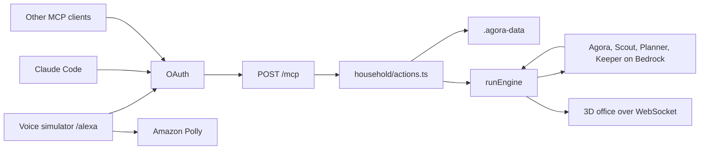

# Architecture

AGORA+ is the household layer on the existing AGORA office. One Node process serves the voice page, the MCP endpoint, the household files, and the office WebSocket.



The runs recorded for this entry are the voice simulator and Claude Code with the development token. MCP clients such as Alexa+ add-ons, Claude, and ChatGPT can connect. Those two were not run, and the add-on manifest still uses `<host>`. Speech audio is Polly when AWS credentials are present, and the browser voice when Polly returns 503. Bedrock runs only with those credentials. Time to first audio and a live model call are `TODO(measure)`.

## Voice simulator

`/alexa` is a separate page so the 3D office does not load there. The route is lazy-loaded from [src/main.tsx](../src/main.tsx). The screen is [src/alexa/AlexaSimulator.tsx](../src/alexa/AlexaSimulator.tsx). The label on the page is an unofficial simulated Alexa+ experience.

A turn is `POST /api/alexa-sim/turn` in [server/alexaSim/bridge.ts](../server/alexaSim/bridge.ts). The first event is a fixed acknowledgement from [server/alexaSim/ack.ts](../server/alexaSim/ack.ts). That phrase does not call a model. The bridge then opens a real MCP client to this server's `/mcp` and calls tools over HTTP. It does not import the action functions. The SSE `final` event includes `runId` when that turn started a run. The latency meter records milliseconds only when audio starts, and says "text only" when it does not.

Remember, recall, the briefing, tasks, the shopping list, reminders, and an exact yes or no match [server/alexaSim/fastPath.ts](../server/alexaSim/fastPath.ts) and skip the voice model. Yes and no are a whole phrase from [server/alexaSim/approvalWords.ts](../server/alexaSim/approvalWords.ts). "yes but not Tuesday" and "yesterday" are not a decision. The model tool list omits `approve_action`. If the model names that tool anyway, the bridge refuses and does not call MCP. A plan still calls Bedrock once inside `plan_and_run` for the step list, and only when that preview returns steps. Set `ALEXA_SIM_FAST_PATH=0` to send every turn through the model loop. The model path uses [server/llm/toolLoop.ts](../server/llm/toolLoop.ts) and Claude on Bedrock. The page shows each `tools/call` under "Under the hood". While the page is open it polls `GET /api/household` about every 30 seconds. An open task whose `dueAt` is already past is due. The page speaks "Reminder: &lt;title&gt;." once per task per page load, and skips a task that was due more than an hour before the page opened. After a yes, it watches `recentRuns` for a run that started at or after that moment and, when the status leaves `running`, speaks `spokenSummary` once.

The microphone uses Web Speech in [src/alexa/useSpeechInput.ts](../src/alexa/useSpeechInput.ts). Typing works when that API is missing. Spoken audio tries `POST /api/tts` and falls back to `speechSynthesis`.

## OAuth and `/mcp`

[server/mcp/http.ts](../server/mcp/http.ts) mounts `createMcpHandler` from `@modelcontextprotocol/server` with `legacy: 'stateless'`, wrapped by `toNodeHandler` from `@modelcontextprotocol/node`. The same handler is attached from the Vite relay and from [server/prod.ts](../server/prod.ts).

The test in [server/mcp/mcp.test.ts](../server/mcp/mcp.test.ts) checks that the negotiated version is at least `2025-11-25`. `legacy: 'stateless'` is how one URL answers an older `initialize` and a newer client. Alexa's published sample sends `2025-03-26`. The specification index on 8 Oct 2026 names 2026-07-28 as current ([docs/council/reports/g4-spec-followup.md](council/reports/g4-spec-followup.md)). Eleven tools are always listed. `web_research` is the twelfth, and only when `FIRECRAWL_API_KEY` or `EXA_API_KEY` is set. A request with no token is 401, with an empty body and no `WWW-Authenticate` header. An Origin outside the allowlist is 403. OAuth and `/mcp` return 503 when `AGORA_PUBLIC_URL` is unset and the process is not bound to loopback.

[server/mcp/oauth.ts](../server/mcp/oauth.ts) publishes the authorization-server and protected-resource metadata. Grants are client credentials, authorization code with PKCE S256, and refresh tokens. Client credentials accept the secret in HTTP Basic or the form body, never both, and the scope is `mcp:service`. The passcode consent page issues `mcp:tools` and `mcp:resources`. `redirect_uri` must match `AGORA_OAUTH_REDIRECT_URIS` exactly. The simulator's own `http://127.0.0.1`, `http://localhost`, or `http://[::1]` callback is always allowed. `state` is required. Access tokens are HMAC-signed and last 3600 seconds. `AGORA_TOKEN_SECRET` and `AGORA_MCP_TOKEN` shorter than 32 characters are ignored. The development token is also ignored when `NODE_ENV=production` or `AGORA_PUBLIC_URL` is https, unless `AGORA_ALLOW_DEV_TOKEN=1`. If the OAuth secrets are unset, those routes return 503 and only that development token can call tools. Refresh records persist in `oauth-refreshes.json` under `AGORA_DATA_DIR`. Reusing a refresh token revokes every refresh record for that subject and bumps a generation counter, so later access tokens for that subject fail. The simulator's linked account is `oauth-sim-account.json` and is loaded again after a restart. Authorization codes are still only in memory. Consent HTML sends `Content-Security-Policy: frame-ancestors 'none'` and `X-Frame-Options: DENY`. Wrong passcodes share the household limiter: 5 misses, then 15 minutes, HTTP 429. `X-Forwarded-Proto` is ignored unless `AGORA_TRUST_PROXY=1`.

Stateless serving builds a fresh server for each request (`legacy: 'stateless'` in the SDK's `createMcpHandler` options). A per-request instance that never saw `initialize` has no session for a server-to-client elicitation. Approvals are a second tool call instead. See below.

## Tools, resources, prompts, and the screen card

Registered in [server/mcp/server.ts](../server/mcp/server.ts):

Tools: `remember`, `recall`, `forget`, `add_task`, `list_tasks`, `complete_task`, `daily_briefing`, `plan_and_run`, `get_run_status`, `approve_action`, `ask_agora`, `web_research`.

Resources: `agora://memory`, `agora://tasks`, `agora://runs/{runId}/document`.

Prompts: `morning-briefing`, `plan-a-week-of-meals`.

`daily_briefing` and `list_tasks` link the MCP Apps card `ui://daily_briefing/household-card.html` on the tool definition and on the tool result (`_meta.ui.resourceUri`), built from [server/mcp/apps/householdCard.ts](../server/mcp/apps/householdCard.ts). The server advertises `io.modelcontextprotocol/ui`. A host that supports MCP Apps can show the briefing, mark a task done, and approve or decline. The spoken line is still the tool's `speech` field. A failed card call replaces "Loading…" with empty lists and the error.

Every tool result carries a `speech` text block and `structuredContent` with `speech` and `status` of `ok`, `needs_approval`, or `error`.

## Actions, files, and the run engine

[server/household/actions.ts](../server/household/actions.ts) is the only write path the tools use. Files go through [server/household/store.ts](../server/household/store.ts): a temp file in the same directory, then `rename`. The directory is `AGORA_DATA_DIR` or `.agora-data`.

| Store | File module | What it holds |
|---|---|---|
| Memory | [server/household/memoryStore.ts](../server/household/memoryStore.ts) | Facts, tags, source, and optional `who` (the person the fact is about) |
| Tasks | [server/household/taskStore.ts](../server/household/taskStore.ts) | Open and finished tasks, with optional `who`, `list`, and `dueAt` |
| Runs | [server/runEngine.ts](../server/runEngine.ts) | `runs/<id>.json` and the markdown document |

A missing memory or task file is empty. Corrupt JSON or a rejected shape is renamed to `<name>.corrupt-<timestamp>.json` and treated as empty, so the next save does not erase the bad file. The same fact, after trim, collapsed space, and case folding, updates the existing row. A leading capitalised name such as "Mia is allergic to peanuts" stores `who` "Mia" unless the caller passed a person. Old rows with no `who` still load.

`daily_briefing` is fixed logic in [server/household/briefing.ts](../server/household/briefing.ts). It does not call a model. Speech is at most two sentences. The first memory sentence prefers an allergy or medicine fact ("Remember: Mia is allergic to peanuts."). An open task whose `dueAt` is already past is spoken as "Reminder: &lt;title&gt;." "Due today" uses `AGORA_TIMEZONE`, or the server zone when that is unset. With an empty house and no memory, the line is still "Nothing urgent at home."

`recall` ranks by content words, prefers a named person, says two facts when the scores tie, and says "I'm not sure, but I have: ..." when the overlap is only partial. `ask_agora` runs the tool loop on the fast Bedrock model, at most four steps. Alexa clients get about 4 seconds. The voice simulator client (`agora-plus-voice`) gets 9 seconds when that name is on the MCP call. A missing model or a timeout falls back to the top saved fact, and that fallback does not use the two-fact sentence. The `ask_agora` output schema does not include `who`. `web_research` is registered only when a key is set. It uses Firecrawl when `FIRECRAWL_API_KEY` is set, otherwise Exa, and the structured result includes `{ title, url }`. Spoken research does not read the URL ([server/research/firecrawl.ts](../server/research/firecrawl.ts), [server/research/research.ts](../server/research/research.ts)). Page fetches go through the guard in [server/proxyGuard.ts](../server/proxyGuard.ts).

`plan_and_run` refuses an order, a purchase, a booking, a reservation, a payment, or a phone call, and returns no `approvalId`. Meals and grocery planning still wait for a yes. A successful preview calls `planSociety` once ([server/society/Orchestrator.ts](../server/society/Orchestrator.ts)) and stores that step list on the approval. Saying yes starts those same steps. There is no second planning call. If the preview throws or returns no steps, the tool says planning is unavailable and does not create an approval.

## The household team and the office

The team is Agora, Scout, Planner, and Keeper ([server/household/team.ts](../server/household/team.ts)). That set is the office default ([src/data/agents.ts](../src/data/agents.ts)). An unknown saved set id, including the old `single-agent` id, resolves to Household. Keeper's job is to check the plan against memory and flag a conflict, such as an allergy. A household run writes `runs/<id>.json` with `status: "running"` when it starts, and writes the file again when it ends, including `spokenSummary` when there is one. `listRecentRuns` is newest first and is what `GET /api/household` returns as `recentRuns` (`id`, `status`, `startedAt`, and `spokenSummary` when set). The `society-complete` payload carries `spokenSummary` when there is one. The Society panel shows that line, headed "Keeper says" when it mentions an allergy or a conflict, otherwise "Spoken summary". A second household start while one is active says "The team is still working on the last plan. Ask me for its status." A second office Execute still says "A run is already in progress." If the finished save fails, the run stays `needs_revision` with an error, in memory and on `society-complete`. If the process dies mid-run, the file can stay `status: "running"`.

[server/runEngine.ts](../server/runEngine.ts) starts the swarm with `runSociety`. When a browser is in the office, events go out through the host socket ([server/hub.ts](../server/hub.ts), [server/relay.ts](../server/relay.ts)) so the 3D office still shows the team. The office code under `src/simulation/` is unchanged. One room, one active run ([server/roomState.ts](../server/roomState.ts)). On loopback with no passcode and no `DEMO_HOST_SECRET`, the first join is the host. On an open bind without that secret, the host seat is the household session when a passcode is set, and the room has no host when it is not.

Model calls use [server/llm/bedrockProvider.ts](../server/llm/bedrockProvider.ts) when `AGORA_SERVER_LLM=bedrock`. The browser can still supply its own OpenAI-compatible connection. [server/routingProvider.ts](../server/routingProvider.ts) uses Bedrock as the fallback when the browser sent no key and Bedrock is on.

## Polly

[server/alexaSim/tts.ts](../server/alexaSim/tts.ts) calls Amazon Polly (`SynthesizeSpeech`, mp3). The default voice is Joanna and the default engine is neural. Acknowledgement phrases are synthesized ahead of time and cached. A missing credential or a Polly error returns 503, and the page speaks with the browser.

## Approval protocol

Two MCP tools have side effects that wait:

- `forget` queues a delete. It does not delete.
- `plan_and_run` queues a swarm. It does not start the team.

Both return `status: "needs_approval"` and an `approvalId`. The summary is the text to show the person. A forget summary is "Forget that &lt;fact&gt;? Say yes or no." The fact in that sentence is clipped at 80 characters. `approve_action` with `decision: "approve"` runs the handler. `decision: "reject"` leaves the data as it is. The handler is marked `running` first. A throw or an `{ ok: false }` result, including a busy room, puts the row back to `pending`, so a later yes can retry. A second overlapping yes sees `running` and does not run the action again.

Waiting approvals live in memory for 10 minutes ([server/household/approvals.ts](../server/household/approvals.ts), `TTL_MS`). Kinds are `forget` and `start_run`. A second process will not see them. A restart drops a waiting yes. [docs/DEPLOY.md](DEPLOY.md) says to run one task for that reason.

The Household panel can add and edit memory over HTTP without that queue ([server/routes.ts](../server/routes.ts)). Delete on the panel asks "Delete? Yes / No" and then calls `DELETE /api/memory/:id`, which still does not create an approval record. Voice and other MCP clients cannot delete that way. The panel's approve and decline buttons call the same `approve_action` path. `POST /api/memory` and `POST /api/tasks` do not pass `who`, `list`, or `dueAt`.

On `/alexa`, a waiting plan turns the ring amber and the approval is an `alertdialog`. An exact yes, or the Approve button, sends `approve_action`. An exact no rejects it. A yes or no with extra words is answered with "I need a plain yes or no." and does not start a run. With no passcode, household routes answer only from a loopback socket. Any other address gets 403 until `AGORA_HOUSEHOLD_PASSCODE` is set. When the passcode is set, `/api/cors-proxy`, `/api/model-test`, and the `/__relay` upgrade need the household cookie.

## Receipts

A write returns a receipt:

```ts
{ action: string; id: string; verified: boolean; at: string }
```

`verified` is a follow-up read, not a claim from the model. For `remember`, the saved text has to match. For `forget`, the id has to be gone. For `complete_task`, the task has to be `done` with the same `completedAt`. The type and the checks are in [server/household/actions.ts](../server/household/actions.ts). The voice page shows the flag on the receipt card. A 429 or throttle from the model is spoken as "The model is busy right now. Try again in a moment."

Spoken text is capped at two sentences and about 220 characters by `toSpeech()` in [server/household/speech.ts](../server/household/speech.ts). Lists and the written plan stay on screen.

## Agent Skill and the Alexa+ add-on

[skills/agora-household/SKILL.md](../skills/agora-household/SKILL.md) tells an agent how to connect, which tool to call, and that a `needs_approval` result waits for a human yes. Field lists are in [skills/agora-household/references/TOOLS.md](../skills/agora-household/references/TOOLS.md). The add-on steps are in [skills/agora-household/references/ALEXA_ADDON.md](../skills/agora-household/references/ALEXA_ADDON.md). The store manifest is [alexa-addon/addon.json](../alexa-addon/addon.json). Privacy and terms are [public/privacy.html](../public/privacy.html) and [public/terms.html](../public/terms.html).
