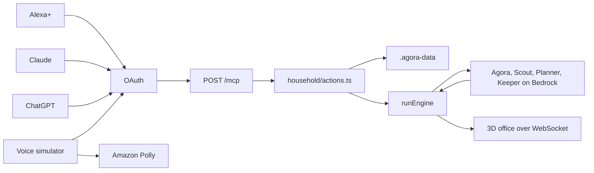

# Architecture

AGORA+ is the household layer on the existing AGORA office. One Node process serves the voice page, the MCP endpoint, the household files, and the office WebSocket.



Alexa+, Claude, ChatGPT, and the voice simulator all reach the same tools. The simulator is a web page. The other three are MCP clients. Speech audio is Polly, with the browser voice when Polly is unavailable.

## Voice simulator

`/alexa` is a separate page so the 3D office does not load there. The route is lazy-loaded from [src/main.tsx](../src/main.tsx). The screen is [src/alexa/AlexaSimulator.tsx](../src/alexa/AlexaSimulator.tsx). The label on the page is an unofficial simulated Alexa+ experience.

A turn is `POST /api/alexa-sim/turn` in [server/alexaSim/bridge.ts](../server/alexaSim/bridge.ts). The first event is a fixed acknowledgement from [server/alexaSim/ack.ts](../server/alexaSim/ack.ts). That phrase does not call a model. The bridge then opens a real MCP client to this server's `/mcp` and calls tools over HTTP. It does not import the action functions.

Remember, the briefing, tasks, and yes/no match [server/alexaSim/fastPath.ts](../server/alexaSim/fastPath.ts) and skip the voice model. A plan still calls Bedrock once inside `plan_and_run` for the step list. Set `ALEXA_SIM_FAST_PATH=0` to send every turn through the model loop. The model path uses [server/llm/toolLoop.ts](../server/llm/toolLoop.ts) and Claude on Bedrock ([server/alexaSim/bridge.ts](../server/alexaSim/bridge.ts)). The page shows each `tools/call` under "Under the hood".

The microphone uses Web Speech in [src/alexa/useSpeechInput.ts](../src/alexa/useSpeechInput.ts). Typing works when that API is missing. Spoken audio tries `POST /api/tts` and falls back to `speechSynthesis`.

## OAuth and `/mcp`

[server/mcp/http.ts](../server/mcp/http.ts) mounts `createMcpHandler` from `@modelcontextprotocol/server` with `legacy: 'stateless'`, wrapped by `toNodeHandler` from `@modelcontextprotocol/node`. The same handler is attached from the Vite relay and from [server/prod.ts](../server/prod.ts).

The handler speaks protocol 2025-11-25. [server/mcp/mcp.test.ts](../server/mcp/mcp.test.ts) checks that the negotiated version is at least `2025-11-25` and that twelve tools are listed. A request with no token is 401, with an empty body and no `WWW-Authenticate` header. An Origin outside the allowlist is 403.

[server/mcp/oauth.ts](../server/mcp/oauth.ts) publishes the authorization-server and protected-resource metadata. Grants are client credentials, authorization code with PKCE S256, and refresh tokens. Client credentials use HTTP Basic and the scope `mcp:service`. The passcode consent page issues `mcp:tools` and `mcp:resources`. Access tokens are HMAC-signed and last 3600 seconds. If the OAuth secrets are unset, those routes return 503 and only `AGORA_MCP_TOKEN` can call tools.

Stateless serving builds a fresh server for each request (`legacy: 'stateless'` in the SDK's `createMcpHandler` options). A per-request instance that never saw `initialize` has no session for a server-to-client elicitation. Approvals are a second tool call instead. See below.

## Tools, resources, prompts, and the screen card

Registered in [server/mcp/server.ts](../server/mcp/server.ts):

Tools: `remember`, `recall`, `forget`, `add_task`, `list_tasks`, `complete_task`, `daily_briefing`, `plan_and_run`, `get_run_status`, `approve_action`, `ask_agora`, `web_research`.

Resources: `agora://memory`, `agora://tasks`, `agora://runs/{runId}/document`.

Prompts: `morning-briefing`, `plan-a-week-of-meals`.

`daily_briefing` and `list_tasks` also link the MCP Apps card `ui://daily_briefing/household-card.html`, built from [server/mcp/apps/householdCard.ts](../server/mcp/apps/householdCard.ts). A host that supports MCP Apps can show the briefing, mark a task done, and approve or decline. The spoken line is still the tool's `speech` field.

Every tool result carries a `speech` text block and `structuredContent` with `speech` and `status` of `ok`, `needs_approval`, or `error`.

## Actions, files, and the run engine

[server/household/actions.ts](../server/household/actions.ts) is the only write path the tools use. Files go through [server/household/store.ts](../server/household/store.ts): a temp file in the same directory, then `rename`. The directory is `AGORA_DATA_DIR` or `.agora-data`.

| Store | File module | What it holds |
|---|---|---|
| Memory | [server/household/memoryStore.ts](../server/household/memoryStore.ts) | Facts, tags, and who asked |
| Tasks | [server/household/taskStore.ts](../server/household/taskStore.ts) | Open and finished tasks |
| Runs | [server/runEngine.ts](../server/runEngine.ts) | `runs/<id>.json` and the markdown document |

`daily_briefing` is fixed logic in [server/household/briefing.ts](../server/household/briefing.ts). It reads due tasks, open tasks, waiting approvals, and recent runs. It does not call a model.

`ask_agora` runs the tool loop on the fast Bedrock model, at most four steps, and gives up after 9 seconds ([server/household/actions.ts](../server/household/actions.ts)). `web_research` uses Firecrawl when `FIRECRAWL_API_KEY` is set, otherwise Exa, then answers from that text ([server/research/firecrawl.ts](../server/research/firecrawl.ts), [server/research/research.ts](../server/research/research.ts)). Page fetches go through the guard in [server/proxyGuard.ts](../server/proxyGuard.ts).

`plan_and_run` calls `planSociety` once ([server/society/Orchestrator.ts](../server/society/Orchestrator.ts)) and stores the step list on the approval. Saying yes starts those same steps. There is no second planning call.

## The household team and the office

The team is Agora, Scout, Planner, and Keeper ([server/household/team.ts](../server/household/team.ts)). Keeper's job is to check the plan against memory and flag a conflict, such as an allergy. A finished household run stores a two-sentence `spokenSummary`. If Keeper flagged a conflict, that summary includes it ([server/runEngine.ts](../server/runEngine.ts)).

[server/runEngine.ts](../server/runEngine.ts) starts the swarm with `runSociety`. When a browser is in the office, events go out through the host socket ([server/hub.ts](../server/hub.ts), [server/relay.ts](../server/relay.ts)) so the 3D office still shows the team. The office code under `src/simulation/` is unchanged. One room, one active run ([server/roomState.ts](../server/roomState.ts)).

Model calls use [server/llm/bedrockProvider.ts](../server/llm/bedrockProvider.ts) when `AGORA_SERVER_LLM=bedrock`. The browser can still supply its own OpenAI-compatible connection. [server/routingProvider.ts](../server/routingProvider.ts) uses Bedrock as the fallback when the browser sent no key and Bedrock is on.

## Polly

[server/alexaSim/tts.ts](../server/alexaSim/tts.ts) calls Amazon Polly (`SynthesizeSpeech`, mp3). The default voice is Joanna and the default engine is neural. Acknowledgement phrases are synthesized ahead of time and cached. A missing credential or a Polly error returns 503, and the page speaks with the browser.

## Approval protocol

Two MCP tools have side effects that wait:

- `forget` queues a delete. It does not delete.
- `plan_and_run` queues a swarm. It does not start the team.

Both return `status: "needs_approval"` and an `approvalId`. The summary is the text to show the person. `approve_action` with `decision: "approve"` runs the handler. `decision: "reject"` leaves the data as it is.

Waiting approvals live in memory for 10 minutes ([server/household/approvals.ts](../server/household/approvals.ts), `TTL_MS`). Kinds are `forget` and `start_run`. A second process will not see them. [docs/DEPLOY.md](DEPLOY.md) says to run one task for that reason.

The Household panel can add, edit, and delete memory over HTTP without that queue ([server/routes.ts](../server/routes.ts)). Voice and other MCP clients cannot. The panel's approve and decline buttons call the same `approve_action` path.

On `/alexa`, a waiting plan turns the ring amber. "yes" or the Approve button sends `approve_action`. "no" rejects it.

## Receipts

A write returns a receipt:

```ts
{ action: string; id: string; verified: boolean; at: string }
```

`verified` is a follow-up read, not a claim from the model. For `remember`, the saved text has to match. For `forget`, the id has to be gone. For `complete_task`, the task has to be `done` with the same `completedAt`. The type and the checks are in [server/household/actions.ts](../server/household/actions.ts). The voice page shows the flag on the receipt card.

Spoken text is capped at two sentences and about 220 characters by `toSpeech()` in [server/household/speech.ts](../server/household/speech.ts). Lists and the written plan stay on screen.

## Agent Skill and the Alexa+ add-on

[skills/agora-household/SKILL.md](../skills/agora-household/SKILL.md) tells an agent how to connect, which tool to call, and that a `needs_approval` result waits for a human yes. Field lists are in [skills/agora-household/references/TOOLS.md](../skills/agora-household/references/TOOLS.md). The add-on steps are in [skills/agora-household/references/ALEXA_ADDON.md](../skills/agora-household/references/ALEXA_ADDON.md). The store manifest is [alexa-addon/addon.json](../alexa-addon/addon.json). Privacy and terms are [public/privacy.html](../public/privacy.html) and [public/terms.html](../public/terms.html).
